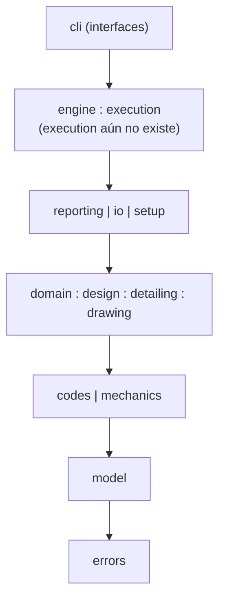
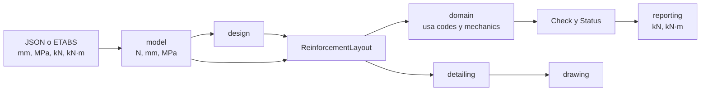

# Arquitectura

Una fuente de verdad por concepto. Las reglas completas están en [AGENTS.md](../AGENTS.md).

## Capas

Cada capa solo importa las que están debajo. `lint-imports` hace cumplir estas fronteras.

`a : b` son módulos de una misma capa que pueden importarse entre sí; `a | b` son módulos
de una misma capa que no pueden hacerlo.

| Módulo | Responsabilidad |
| --- | --- |
| `cli` | Interfaz. Llama a `engine`/`execution`; nunca calcula capacidades. |
| `engine`, `execution` | Orquestación, sin reglas de cálculo. |
| `reporting` | Presentación. Convierte unidades de salida con `kN()` y `kNm()`. |
| `io/etabs` | Importación de fuerzas mayoradas desde ETABS. |
| `setup` | `load_engine()`: carga las tablas de `data/` con `importlib.resources`. |
| `domain/<elemento>` | Elige la cláusula y arma cada `Check`. `domain/status.py` tiene la única agregación de estados. |
| `design/<elemento>` | Produce `ReinforcementLayout`. |
| `detailing`, `drawing` | Neutros: usan límites ya calculados por el perfil; sin fórmulas normativas. |
| `codes/<perfil>` | Fórmulas y constantes como funciones puras con el nombre de su ecuación o numeral. |
| `mechanics` | Equilibrio, compatibilidad, fibras, Icr. No conoce φ ni numerales. |
| `model` | Datos del proyecto y `ReinforcementLayout`. Convierte unidades al cargar. |
| `errors` | Errores estructurados con código estable. |
| `data` | Tablas CSV o TOML, sin código. |

## Fronteras de import

Contratos en `pyproject.toml`:

1. **Capas:** el orden del diagrama. Todo módulo nuevo del paquete debe ubicarse en una capa;
   solo `data` queda fuera, porque no tiene código.
2. **Perfiles independientes:** `codes.aci_318_25` y `codes.nsr_10` no se importan entre sí.
3. **`codes` aislado:** no importa ninguna otra capa del paquete, tampoco `model` ni `errors`.

`tests/test_conformity.py` verifica que ambos perfiles expongan los mismos módulos, nombres
públicos y firmas. `codes/registry.py` es el único punto que conoce a los dos perfiles: los
expone sin que uno importe al otro. Lo no implementado en un perfil devuelve `BLOCKED`; nunca se usa la
fórmula del otro.

## Flujo de datos

`ReinforcementLayout` es el contrato central: lo produce `design/`, lo evalúa `domain/` y lo
consumen `detailing/` y `drawing/`. La hoja de ruta verifica vigas (Fase 2) antes de
diseñarlas (Fase 4), por lo que también podrá llegar desde la entrada. Las fuerzas llegan mayoradas: la v1 no genera combinaciones.
Las unidades se convierten solo al cargar y al presentar.

`model` comprueba la forma de la entrada, sin conocer la norma. `domain` la compara con el
perfil, por ejemplo que el nivel sísmico exista en él, y toma de `codes` los valores que
`mechanics` recibe como números (εcu, 0.85, β1 y Es).

Por estación, `domain/beam/station.py` comprueba el alcance de viga (tipo de miembro y
Pu < 0.10 f'c·Ag) y reúne las verificaciones de flexión y cortante:

- `domain/beam/flexure.py` pide a `mechanics` el estado con Pn = Pu y momentos respecto al centroide
  bruto, y arma los `Check` con φ, εt mínima y As,min de `codes/<perfil>/flexure.py`.
- `domain/beam/shear.py` comprueba que la torsión sea despreciable (`codes/<perfil>/torsion.py`),
  toma d y ρw del acero a tracción del estado a flexión, y arma los `Check` con Vc, Vs, Av,min y
  separaciones de `codes/<perfil>/shear.py`.
