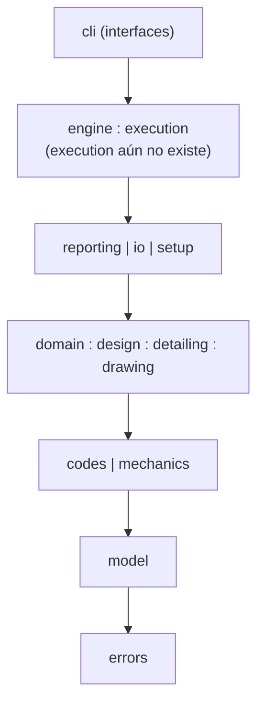
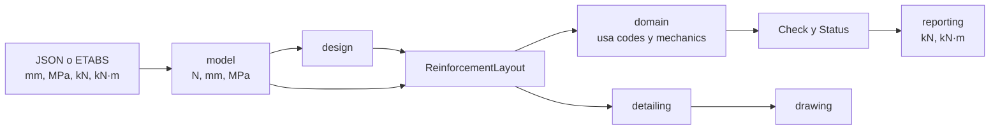

# Arquitectura

Una fuente de verdad por concepto. Las reglas completas están en [AGENTS.md](../AGENTS.md).

## Capas

Cada capa solo importa las que están debajo. `lint-imports` hace cumplir estas fronteras.

`a : b` son módulos de una misma capa que pueden importarse entre sí; `a | b` son módulos
de una misma capa que no pueden hacerlo.

| Módulo | Responsabilidad |
| --- | --- |
| `cli` | Interfaz. Llama a `engine`/`execution`; nunca calcula capacidades. |
| `engine`, `execution` | Orquestación, sin reglas de cálculo. |
| `reporting` | Presentación: `results.py` arma el resultado en unidades de salida (`kN()`, `kNm()`, 6 cifras), `memoir.py` la memoria en texto desde ese resultado y `pdf.py` el PDF. No calcula capacidades. |
| `io/etabs` | Lee el Excel de ETABS con la biblioteca estándar y arma el proyecto JSON desde una plantilla (D-042). Convierte el formato de ETABS al de entrada: m a mm y la compresión positiva. `footings.py` cruza las reacciones de servicio y mayoradas y las convierte en acciones sobre la zapata (D-055). |
| `setup` | `load_engine()`: carga las tablas de `data/` con `importlib.resources`. |
| `domain/<elemento>` | Elige la cláusula y arma cada `Check` (`beam/`, `footing/`). `domain/status.py` tiene la única agregación de estados y `domain/flexure_strength.py` y `domain/shear_strength.py` la resistencia a flexión y a cortante común a todos los elementos (D-060, D-063). |
| `design/<elemento>` | Produce `ReinforcementLayout`. |
| `detailing`, `drawing` | Neutros: usan límites ya calculados por el perfil; sin fórmulas normativas. |
| `codes/<perfil>` | Fórmulas y constantes como funciones puras con el nombre de su ecuación o numeral. |
| `mechanics` | Equilibrio y compatibilidad de una sección poligonal con eje neutro de cualquier inclinación (`section.py`); `flexure.py` describe la flexión uniaxial por franjas sobre el mismo motor. `soil_pressure.py` da la presión lineal del suelo bajo una zapata rígida (Bellos y Bakas 2017, D-053), `polygon.py` el recorte y las integrales exactas que ambos usan y `perimeter.py` el perímetro crítico del cortante en dos direcciones. No conoce φ ni numerales. |
| `model` | Datos del proyecto y `ReinforcementLayout`; `footing.py` describe la zapata y calcula sus propiedades derivadas (área, inercias, módulos, núcleo central y pesos). Convierte unidades al cargar. |
| `errors` | Errores estructurados con código estable. |
| `data` | Tablas CSV o TOML, sin código. |

## Fronteras de import

Contratos en `pyproject.toml`:

1. **Capas:** el orden del diagrama. Todo módulo nuevo del paquete debe ubicarse en una capa;
   solo `data` queda fuera, porque no tiene código.
2. **Perfiles independientes:** `codes.aci_318_25` y `codes.nsr_10` no se importan entre sí.
3. **`codes` aislado:** no importa ninguna otra capa del paquete, tampoco `model` ni `errors`.

`tests/test_conformity.py` verifica que ambos perfiles expongan los mismos módulos, nombres
públicos y firmas. `codes/registry.py` es el único punto que conoce a los dos perfiles: los
expone sin que uno importe al otro. Lo no implementado en un perfil devuelve `BLOCKED`; nunca se usa la
fórmula del otro.

## Flujo de datos

`ReinforcementLayout` es el contrato central: lo produce `design/`, lo evalúa `domain/` y lo
consumen `detailing/` y `drawing/`. La hoja de ruta verifica vigas (Fase 2) antes de
diseñarlas (Fase 4), por lo que también podrá llegar desde la entrada. Las fuerzas llegan mayoradas: la v1 no genera combinaciones.
Las unidades se convierten solo al cargar y al presentar.

`model` comprueba la forma de la entrada, sin conocer la norma. `domain` la compara con el
perfil, por ejemplo que el nivel sísmico exista en él, y toma de `codes` los valores que
`mechanics` recibe como números (εcu, 0.85, β1 y Es).

`domain/beam/geometry.py` ubica cada barra longitudinal en la sección (D-040). Por estación,
`domain/beam/station.py` comprueba el alcance de viga (tipo de miembro y
Pu < 0.10 f'c·Ag) y reúne las verificaciones de flexión y cortante:

- `domain/beam/flexure.py` pide a `mechanics` el estado con Pn = Pu y momentos respecto al centroide
  bruto, y arma los `Check` con φ, εt mínima y As,min de `codes/<perfil>/flexure.py`.
- `domain/beam/torsion.py` calcula el umbral de torsión con las alas efectivas. Si Tu < φTth, la
  estación sigue con `domain/beam/shear.py` (Vc, Vs, Av,min y separaciones de `codes/<perfil>/shear.py`);
  si no, arma la verificación combinada con `codes/<perfil>/torsion.py`. Ambos toman d y ρw del acero a
  tracción del estado a flexión.

En zapatas (v3), `domain/footing/base.py` traslada las fuerzas de la columna y los pesos propios al centroide de
la base, y `domain/footing/service.py` pide a `mechanics/soil_pressure.py` la presión con cada caso de servicio y
arma las verificaciones de presión admisible y contacto. `domain/footing/loads.py` calcula una vez la carga neta de
cada caso mayorado; con ella, `domain/footing/flexure.py` arma la flexión (resistencia de `domain/flexure_strength.py`)
y `domain/footing/shear.py` el cortante en una dirección y el punzonamiento (`domain/shear_strength.py`), con las
barras que ubica `domain/footing/mesh.py`. Los numerales salen de `codes/<perfil>/footing.py`.
